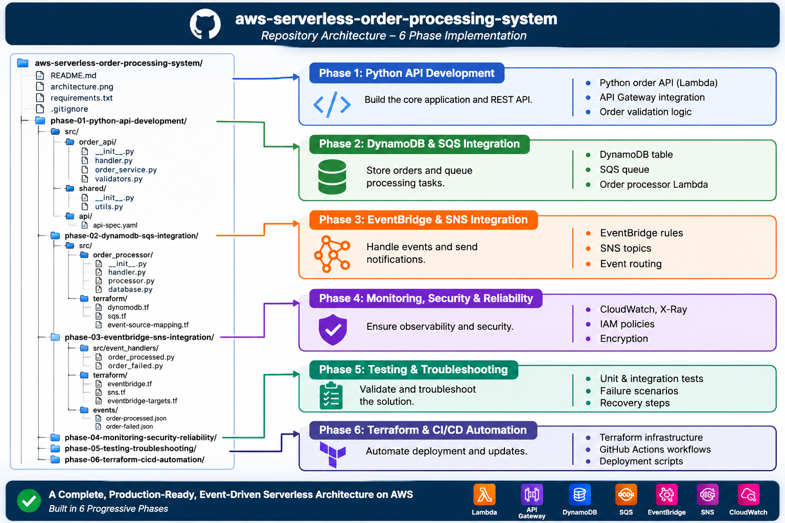

Project 2 — Event-Driven Serverless Order Processing System

An AWS production-style application built with Python, Terraform and serverless services.
The application will simulate an online ordering system. A customer places an order through an API. AWS processes the order asynchronously, stores the information, generates events and sends notifications.

This gives every AWS service a specific job in one connected application.
1. What the application will do
Imagine a customer submits an order:
1. The customer submits an order through the REST API.
2. API Gateway sends the request to a Python Lambda function.
3. Lambda validates the order and saves the initial order record in DynamoDB.
4. Lambda sends an order-processing message to Amazon SQS.
5. SQS holds the message until a processing Lambda is ready.
6. SQS triggers the processing Lambda.
7. The processing Lambda processes the order and updates its status in DynamoDB.
8. The processing Lambda publishes an OrderProcessed event to EventBridge.
9. EventBridge receives the event and evaluates its routing rules.
10. EventBridge routes the event to SNS.
11. SNS sends an order confirmation notification to the customer.

Implementation Workflow

Phase 1 — Python Application and API Development
1. Create the Python order-processing application.
2. Develop order submission and validation logic.
3. Develop order ID generation.
4. Create API Gateway REST API using Terraform.
5. Create the Order API Lambda function.
6. Connect API Gateway to Lambda.
7. Create POST /orders endpoint for submitting orders.
8. Create GET /orders/{order_id} endpoint for retrieving order status.
9. Test API endpoints using Python Requests.

Phase 2 — DynamoDB and SQS Integration
1. Create a DynamoDB table using Terraform.
2. Design the order data structure.
3. Configure Lambda permissions to access DynamoDB.
4. Connect the Order API Lambda to DynamoDB.
5. Save new orders with PENDING status.
6. Create an SQS order-processing queue using Terraform.
7. Configure Lambda to send order messages to SQS.
8. Create the Order Processor Lambda function.
9. Configure SQS event source mapping to trigger the Order Processor Lambda.
10. Process incoming order messages.
11. Update DynamoDB order status to PROCESSING and then COMPLETED.
12. Configure SQS visibility timeout, message retention and retry settings.
13. Create an SQS Dead-Letter Queue (DLQ).

Phase 3 — EventBridge and SNS Integration
1. Create an EventBridge custom event bus.
2. Configure the Order Processor Lambda to publish events to EventBridge.
3. Publish OrderProcessed events after successful processing.
4. Publish OrderFailed events when order processing fails.
5. Create EventBridge rules for different order events.
6. Configure EventBridge to route OrderProcessed events to SNS.
7. Configure EventBridge to route OrderFailed events to a separate notification target.
8. Create SNS topics for order confirmations and failure alerts.
9. Configure email subscriptions.
10. Test end-to-end event routing and notifications.

Phase 4 — Monitoring, Security and Reliability
1. Create IAM roles and policies for API Gateway, Lambda, SQS, EventBridge, SNS and DynamoDB.
2. Implement least-privilege IAM permissions.
3. Configure AWS X-Ray tracing.
4. Configure CloudWatch logs for Lambda functions.
5. Create CloudWatch alarms for Lambda errors and SQS queue backlogs.
6. Monitor failed messages and DLQ activity.
7. Implement idempotency to prevent duplicate order processing.
8. Configure secure environment variables and Secrets Manager where needed.
9. Configure encryption for SQS queues and DynamoDB.
10. Test application failure and recovery scenarios.

Phase 5 — Testing and Troubleshooting
1. Test order submission through API Gateway.
2. Test order storage in DynamoDB.
3. Test message delivery to SQS.
4. Test SQS-triggered Lambda execution.
5. Test order processing and status updates.
6. Test EventBridge event publishing and routing.
7. Test SNS email notifications.
8. Test SQS retries and DLQ handling.
9. Test duplicate message handling.
10. Troubleshoot application failures using CloudWatch and X-Ray.

Phase 6 — Terraform and CI/CD Automation
1. Organize Terraform infrastructure into reusable modules.
2. Configure Terraform remote state using S3 and state locking.
3. Configure GitHub Actions workflows.
4. Automate Terraform formatting and validation.
5. Automate infrastructure deployment.
6. Configure AWS authentication using GitHub OIDC.
7. Automate Python application testing.
8. Automate deployment of Lambda functions.
9. Implement deployment verification.
10. Document the complete infrastructure and application architecture.
